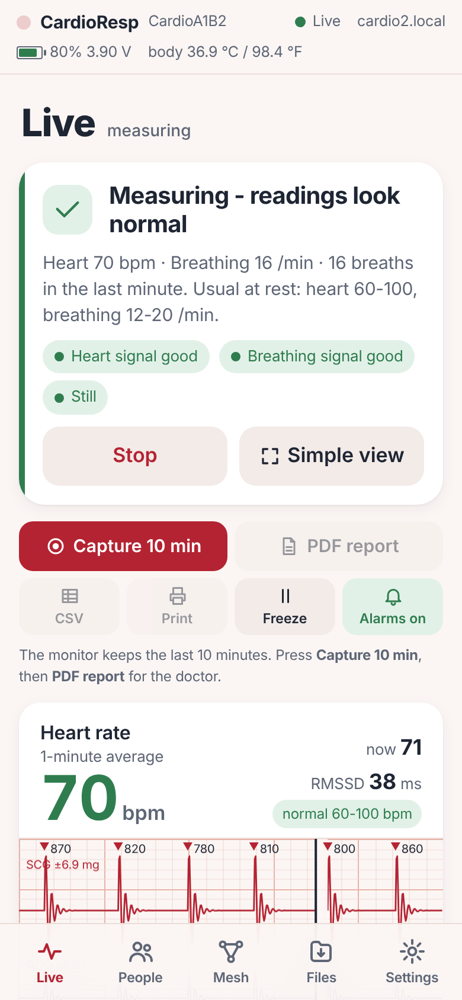
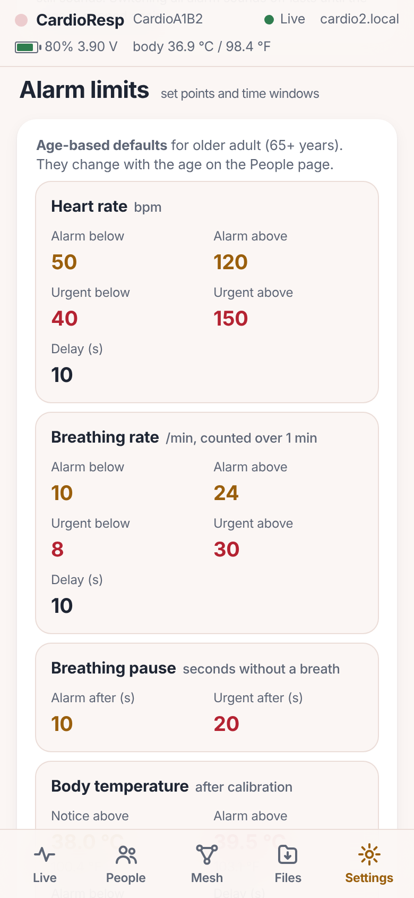
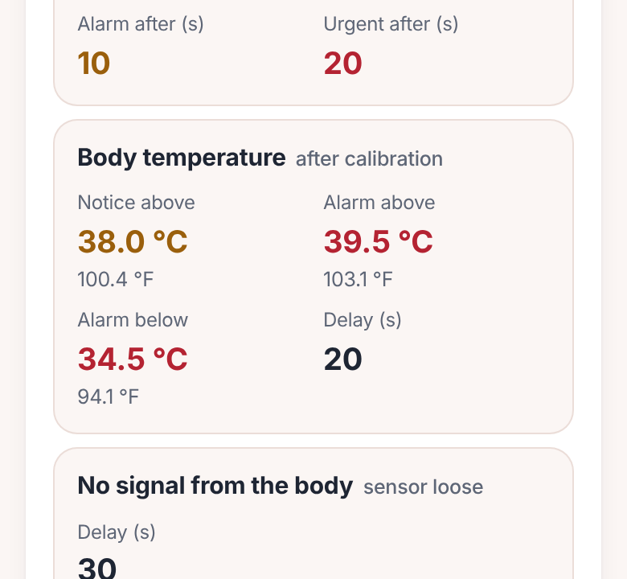

# CardioResp Monitor

Heart-rate and breathing-pattern analyser built from a small Wi-Fi **controller** board and a 6-axis motion **sensor**.
The sensor rests on the chest wall; the controller detects heart beats from chest vibration
(seismocardiography, SCG) and chest rotation (gyrocardiography, GCG), measures breathing
from the tilt of the ribcage relative to gravity, and serves a live dashboard to a phone
over its own Wi-Fi network. The last 10 minutes can be exported as a PDF report for a
doctor or as CSV data.



> **Not a medical device.** This is a research / wellness instrument. It does not replace
> ECG, pulse oximetry or clinical examination. See *Limitations* below.

---

## What is new in v1.3

**Measurement fixes (each problem was first reproduced in the PC simulator, then fixed and re-tested):**

| Problem reported | Cause | Fix |
|---|---|---|
| Fast breathing raised the **heart rate** instead of the breath count | Fast breathing was taken for body movement, so breaths were thrown away, and the strong breathing shake was counted as heart beats | Movement is now judged from gravity-free acceleration, fast rotation and large turns only, so breathing itself (also deep or fast) is never "movement". While strong breathing shakes the chest, the heart rate is **paused** (marked on the heart card) instead of locking onto the breathing rate, and a half-rate lock is corrected by itself |
| Deep breathing showed a **flat** trace | Very deep breaths were also taken for movement and the breath detector's thresholds rose too slowly | Same movement fix; the breath detector adapts within a few breaths |
| Moving was captured as **cough** | Any vibration burst counted | A cough must be a short explosive burst (0.15-0.7 s) with quiet before and after and little rotation; arm movements, taps, rubbing, talking and turning are rejected |
| COVID was suggested from 30 s of data | Rules worked on the last 30 s | Illness patterns now need a **minute-by-minute record**: chest infection (COVID-19, flu, pneumonia) and sleep apnoea need **30 calm minutes**, lasting irregular rhythm 5 min, periodic breathing 10 min, body-wide stress 20 min. The page shows the progress ("Long-term checks: 12 of 30 calm minutes") |

Simulation (`host_test/sim_scen.cpp`, 14 simulated people, 56 checks): **v1.3 passes 56 of 56, the v1.2 engine 40 of 56.**
With v1.2 the heart rate was off by up to 43 bpm during panting and 37 bpm during fast breathing with a weak heart signal,
locked onto the breathing rhythm for 6 s during forceful breathing, a false breathing pause followed very deep breaths, and
12 arm movements, taps and an infant's kicks were counted as coughs. With v1.3: fast breathing 45 and 65 /min is shown as
44.4-44.9 and 64.9-65.8 /min, the heart rate stays within 8 bpm and never follows the breathing, 0 false coughs, real coughs
are still found, and there is no false pause. The original 10-minute accuracy scenarios are unchanged (11/11, 12 orientations).

**Dashboard (cleaner layout in the familiar v1.2 colours, plain language):**
* **Start measurement** button at the top of the Live page. After power-up the monitor waits (READY) and shows the
  **sensor placement and gravity** live, so the sensor can be placed before measuring. Start = 8 s calibration, then
  measuring. **Stop** asks for confirmation. If the power fails while measuring, the monitor **continues by itself**.
* A **status panel** says in one sentence what is happening ("Measuring - readings look normal", "Breathing faster than
  usual", "Breathing pause 25 s - check the person now") with simple checks (signal good, still, posture).
* **Sensor placement and gravity is always shown**: before Start, while calibrating, while measuring, and **with or
  without a licence**. A drawing shows where to fix the sensor (lower breastbone, Y towards the head, Z out of the chest);
  the gravity bubble shows the posture (lying on the back, sitting, on the side, upside down) and the start position.
* The big breathing number follows the **newest breaths** (a change shows within a few breaths), next to the breaths
  **counted in the last minute** and the 5-minute average.
* New alarms: **No signal from the body** (sensor loose), **Measurement stopped** (stopped at the monitor or from another
  phone), **Battery low**. No heart-rate alarm while the heart rate is paused by strong breathing.
* **Simple view** (button on the Live page): full screen with only the heart rate and the breathing pattern, big enough to
  read across a room, in light or dark. Alarms still show on top of it and sound. It is remembered on that phone; close it with x.
* **Alarm limits for doctors and nurses** (Settings -> Alarm limits): for heart rate, breathing rate, breathing pause, body
  temperature and "no signal from the body" there is an alarm limit, an urgent limit and a delay (time window: how long the
  value must stay beyond the limit before the alarm sounds). The defaults follow the patient's age (adult: heart rate alarm
  below 50 / above 120, urgent below 40 / above 150 bpm; breathing below 10 / above 24, urgent below 8 / above 30 per minute;
  pause alarm after 10 s, urgent after 20 s; delays 10 s). Everybody can see the limits; **changing them needs the doctor /
  nurse PIN** (factory PIN `1234`, set by `CLINICIAN_PIN_DEFAULT` in `config.h` - change it on the page at first use). The
  PIN is stored only as a salted hash; 5 wrong PINs lock the entry for 1 minute (then 2, 4 ... minutes). A sign-in lasts 30
  minutes on that phone; every change is kept with the name of the person and the time, and the last 8 changes are listed.
  The limits live on the monitor, so every phone uses the same ones. (The written assessment keeps using the normal resting
  ranges for the age.)

  
* **Body temperature in °C and °F everywhere:** the header chip and the temperature tile on the Live page, the alarm
  limits (each value shown in both; when editing, a **°C / °F switch** lets the nurse type in either unit and the other unit
  is shown next to the box; the monitor keeps °C), the alarm list and alarm messages, the assessment evidence, the
  recording report (summary rows in °C and °F, temperature chart with a °C scale left and a °F scale right) and the CSV
  (`temp_c`, `temp_f`). The thermometer calibration accepts a reading in °C or °F.

  
* **Simple addresses for many monitors on one Wi-Fi:** the first monitor is **http://cardio.local**, the next
  **cardio2.local**, **cardio3.local** ... The monitor checks which names are already used, keeps its name across restarts
  and still answers to its old unique name (cardio-xxxxxx.local). Settings -> Network shows the address, the IP address
  (for phones that do not open .local names) and two **QR codes**: scan to open the monitor, scan to join its own Wi-Fi. The
  Mesh page lists **all monitors on the same Wi-Fi** with their bed / room label; tap one to open it.
* **Captive portal also while on Wi-Fi:** the monitor's own network (the one that opens the page by itself) now stays on
  next to the home Wi-Fi by default (`AP_ALWAYS_ON`, switchable in Settings -> Network), so anybody nearby can join it
  directly. Any address typed on that network opens the page at http://192.168.4.1. If the home Wi-Fi disappears, the
  monitor stops searching for it after 8 s so that its own network stays usable, and retries in the background.
* Settings: **Restart monitor** and **Factory reset** (the licence is kept unless "Also remove the licence key" is ticked;
  a factory reset also restores the default alarm limits and the factory PIN).

**Updating from v1.2:** the flash layout is unchanged, so no cable is needed: Settings -> Firmware update -> choose the
v1.3 application `.bin` (or `merged.bin`). Settings, recordings and the licence are kept. From older versions, or on a
new board, flash `merged.bin` at address 0x0 over USB once.

**Controller:**
* The sensor is found on **SDA 8 / SCL 9** (as before) **or SDA 6 / SCL 7** automatically. With 6/7 the blue LED (GPIO 8)
  becomes a status light and the BOOT button (GPIO 9) a Start/Stop button (see *1. Hardware*).
* Fixed: replies such as "firmware installed" or "offset saved" were sent as broken JSON (the page could say "Update
  failed" after a successful update).

**How v1.3 was checked, and what that does not cover:** the firmware was compiled for the controller (no warnings); the
signal processing ran in the PC simulators (`sim_test`, `sim_scen`, `sim_abnormal`); the controller and page assessments
were cross-checked (10 470 identical verdicts); the name, alarm-limit/PIN, mesh-signature and calibration logic have their
own PC tests; and the dashboard was driven in a real browser (Chromium, phone and desktop sizes) against a simulated monitor
(`testdata/ui_test_v13.py`, 148 checks, including decoding the QR codes and entering temperature limits in °F). None of this replaces a test on the real hardware
with a real person: compare the readings once against a pulse oximeter / ECG and a counted breathing rate before relying
on them, and check the alarm limits with the doctor. The local-name search, the captive portal on phones and the
own-network-next-to-Wi-Fi mode depend on the phones and routers used and were not tested on real devices.

---

## Final v1.2 dashboard (navigation, alarms, reports)

* **Navigation:** a bottom bar on phones and a left side bar on tablets / computers, always visible: **Live, People, Mesh, Files, Settings**.
  Each page has its own colour. Old links (`#patient`, `#nurse`, `#analysis`, `#about`) still work.
* **Live page, top to bottom:** toolbar (**Capture 10 min**, **PDF report**, CSV, Print, Freeze, Alarms on/off) - captured
  report - heart card - breathing card (with **Flip** for the breathing direction) - assessment - chest vibration and temperature -
  **Sensor placement and gravity** (the 2-D gravity "bubble level" with roll/pitch, axis up and tilt since calibration) -
  **Detailed analysis** as a drop-down (interpretation, trends, beat intervals, Poincaré plot, breaths, spectra, signal axes; closed by default).
* **Typed sound alarms** (`web/alarms.js`), each with its own sound, so the sound alone tells what is wrong:

  | Alarm | Starts when | Priority | Sound |
  |---|---|---|---|
  | Heart signal lost | assessment reports the heartbeat vibration lost while still (licence) | urgent, always on | fast high burst (3 + 2) |
  | Breathing pause | no breath longer than the age limit; urgent from 20 s (works without licence) | warning / urgent, always on | high-low siren |
  | Heart rate or rhythm | heart rate clearly outside the age range for 10 s (urgent when far outside), irregular rhythm | warning / urgent | three equal beeps |
  | Breathing rate or pattern | last-minute rate clearly outside the range for 10 s, laboured breathing, repeated pauses | warning / urgent | three falling tones |
  | Body temperature | >= 38.0 °C (100.4 °F) or < 34.5 °C (94.1 °F) for 20 s, only after temperature calibration | notice / warning | two slow tones |
  | Chest vibration or coughing | repeated cough bursts, or strong vibration while still (licence) | notice | two rising chirps |
  | Sensor lost | sensor cable disconnected (3 s) | warning, always on | two low buzzes |
  | No data from the monitor | nothing received for 15 s (urgent if an urgent alarm was active) | warning / urgent, always on | three low buzzes |

  Urgent alarms repeat every 4 s (and vibrate the phone), warnings every 10 s, notices every 20 s. Only the most urgent
  alarm sounds; all are listed on the coloured alarm bar. Conditions need a hold time (most readings within it) so a single
  odd reading never starts an alarm. **Silence 2 min** mutes the current alarms; a new, returning or worsening alarm still
  sounds. Settings has the volume, a Test button per sound, and on/off for the non-safety alarms. Browsers play sound only
  after the page has been tapped once (the alarm bar says so) and only while the page is open with the screen on.
  This is an early-warning aid, **not a certified medical alarm system**.
* **Detailed analysis** (Live page drop-down): **charts first, text below**: trend (10 min / 1 h / all), beat intervals,
  Poincaré plot, signal axes; **advanced tools**: average heartbeat (ensemble-averaged SCG/GCG with beat-to-beat
  consistency), beat-interval histogram with HRV statistics (SDNN, RMSSD, pNN50, SD1/SD2, CV), breath-by-breath rate and
  depth; spectra; then the written interpretation, the **alarm and event log** (CSV download) and the recent breaths.
* **Notifications can be closed** with ×: calibration, alerts, licence and tips stay hidden until their message changes;
  × on the alarm bar silences the current alarms for 2 minutes and hides the bar until a new or worse alarm starts.
* **Mesh settings with PIN verification** (Settings -> Mesh network, `/api/mesh/config`): group name, PIN (4-8 digits or
  open), monitor label, send interval (1-10 s) and relay hops (0-3), stored in flash. Every mesh packet is signed:
  key = SHA-256(group + PIN), tag = HMAC-SHA256 (8 bytes) over the packet without the hop fields (`MeshAuth.h`). Only
  verified packets are used or relayed. **Verify nearby monitors** (`POST /api/mesh op=verify`) lists every monitor in
  range as verified, wrong PIN, other group or older firmware. Defaults: `MESH_GROUP_DEFAULT`, `MESH_PIN_DEFAULT` in
  `config.h` (an older `config.h` without them still compiles: group "ward", no PIN). All monitors of a mesh need this
  firmware; older units are listed but not used.
* **PDF results report from stored recordings** (Files page): per recording, or one PDF of all recordings: patient and
  nurse, summary table (mean/min/max, age reference, % outside the range), assessment timeline, findings, heart-rate /
  breathing-rate / temperature trends with the reference band, and (with waveforms) a 10-s SCG/GCG strip and the breathing trace.
* **Settings:** Theme (Auto / Light / Dark, remembered on the phone), alarm sounds, **Calibration** (recalibrate sensor,
  restart measurement, 6-position accelerometer calibration, body-temperature calibration), power and heat mode, network,
  system, licence, firmware update and About.
* **Signals are never masked:** the SCG/GCG and breathing traces are always drawn, also during movement (marked amber and
  left out of the rates); the scale grows instead of clipping.
* **Heat:** runtime power profiles (Settings -> Power and heat mode, `/api/power`): Performance (160 MHz), **Cool** (80 MHz,
  default), Eco (80 MHz, slowest streams). Default: `POWER_PROFILE_DEFAULT` in `config.h` (an older `config.h` without it
  still compiles and uses Cool). The effect on real hardware was not measured here; the controller board will still feel warm.
* **Licence key:** the master secret is never stored in the firmware. Put only the derived key in `config.h`
  (`LICENSE_AES_KEY_HEX`) or run `python tools/set_license_key.py`. `AP_FIXED_PASSWORD` sets a fixed hotspot password.

## What is new in v1.2

| # | Feature | Where |
|---|---|---|
| 1 | Multi-page dashboard: **five pages**: Live (live + analysis drop-down), People (patient + nurse), Mesh, Files, Settings (settings + about) | bottom bar (phone) / side bar (computer) |
| 2 | Abnormal heart/breathing values are **never hidden**: the numbers change colour (green, amber, orange, red) with the age-referenced zone; chest-vibration RMS/peak/high-frequency share, cough bursts and body temperature are coloured the same way | Live |
| 3, 14 | Tiny ML model (21 inputs, 14 ReLU, 7 classes: normal, tachycardia, bradycardia, irregular rhythm, fast/laboured breathing, apnoea/slow breathing, coughing) on the controller **and** in the page; written result: headline, suspected condition, prediction score, reliability index, supporting evidence, missing-input notes | Live card, `Analytics.h`, `web/analytics.js` |
| 15, 12 | Rule engine: age zones + spectral rules + event rules (apnoea, no-pulse / cardiac-arrest pattern, worsening trend, respiratory-infection pattern, cough bursts). Combined severity Normal / Watch / Warning / Alert. Rules and ML are fused; disagreements are stated | same |
| 4 | Firmware update from Settings (accepts `merged.bin`, also the application `.bin`) with progress bar; optional password `OTA_PASSWORD` | Settings |
| 5, 20 | peer-to-peer radio (Wi-Fi based) mesh: every monitor shows every patient (name, HR, RR, temperature, severity, ML class, signal, hops); **Update all** asks all monitors for fresh data | Mesh |
| 6, 11, 13 | Licence from the activation key generator page (AES-128-GCM, bound to the board MAC, with expiry). Without a valid key, or after expiry: **only HR and RR** (no waveforms, spectra, rules or ML). A banner and a *Request a new licence* button (WhatsApp to the designer) appear | Settings, banner |
| 7 | Accelerometer 6-position calibration | Settings |
| 8 | Designer name, email, phone, WhatsApp (edit in `config.h`) | Settings (bottom) |
| 9 | Record about 1 minute (30-120 s) to flash; download one file as CSV, all as a ZIP of CSV, or raw `.crr` | Files |
| 17 | Heat: 160 MHz CPU, 10 Hz waveform stream, waveforms only on the visible page, thermal governor (`THERMAL_LIMIT_C`), optional modem sleep (`STA_MODEM_SLEEP`) | `config.h` |
| 18 | Live monitoring of everything: vitals, vibration, temperature, battery, memory, analysis time, mesh, recording | Live / Settings |
| 19 | Patient and nurse profiles on separate pages, stored on the monitor and shown on the mesh | People |
| 21 | Sensor temperature in degC and degF, with a one-point calibration against a thermometer | Live, Settings |

### Install v1.2 (one-time USB flash, because the flash layout changed)
1. Edit `config.h`: `DESIGNER_*`, `AP_PASSWORD_SALT`, and (for licensing) the key, see below.
2. Flash `firmware/merged.bin` at address **0x0** with the controller's USB flash tool (`write_flash 0x0 merged.bin`), or build with PlatformIO / Arduino IDE using `CardioRespMonitor/partitions.csv` (two OTA slots + LittleFS).
3. Later updates need no cable: Settings -> Firmware update -> choose the new `merged.bin`.

### Licence setup
1. Open the activation key generator page (from your package) and note your master secret.
2. Give the monitor the key in one of four ways: (a) easiest: type the master secret in `LICENSE_MASTER_SECRET` in `config.h` (the monitor derives the key itself on first boot and caches it; the secret is then inside the firmware, so use this only for your own units); (b) run `python3 tools/set_license_key.py`, which derives the key and writes `LICENSE_AES_KEY_HEX`; (c) put the 32 hex digits in `LICENSE_AES_KEY_HEX` by hand; (d) type `lickey <32 hex digits>` in the Serial Monitor (kept in flash). **The key is never sent to the browser.**
3. In the generator enter the board MAC (shown on Settings), the user and the expiry date; paste the token into Settings -> Licence -> Activate.
4. Set `LICENSE_ENABLED 0` to disable licensing during development.
The expiry is only enforced once the clock is trustworthy (phone time, SNTP and a stored never-go-back floor). Changing the phone date backwards does not extend a licence.

### Mesh notes
peer-to-peer radio (Wi-Fi based) needs every monitor on the **same Wi-Fi channel**. Monitors in direct (access-point) mode use channel 6 by default (`AP_CHANNEL`); monitors joined to a router follow the router's channel, so keep all of them on the same router, or all in direct mode. Switch the mesh on on every monitor (Mesh page). *Update all* refreshes the data of every monitor; it does not push firmware to other monitors (update each one from its own Settings page).

### Recording files
`recNNNN.crr` (binary, about 40 bytes/s, plus 560 bytes/s of waveform with a licence). The Files page converts them to CSV in the browser: one row per second (HR, RR, signal quality, severity, temperature, RMSSD) followed by the 100 Hz SCG/GCG waveform and 10 Hz chest-tilt blocks.

### Training the model (Google Colab)
Open `ml/CardioResp_Colab.ipynb` in Colab. It mounts Google Drive, downloads PhysioNet datasets **once** (CEBS ECG+breathing+seismocardiogram, AFDB, Apnea-ECG, BIDMC; cached under `MyDrive/CardioResp/datasets`), accepts your own data banks (CSV, or CSV files exported from the Files page), trains the 21-14-7 network with a subject-wise test split, and saves training data, parameters, metrics, 300-dpi figures and the exported `MlModel.h`, `mlmodel.js`, `model.json` under `MyDrive/CardioResp/results/<run>/`. Upload the `ml` folder (or `cardioresp_ml.zip`) to Drive first.
The shipped model is a **baseline trained on synthetic physiological distributions**; replace it with a model trained on real, labelled data before relying on it.

### Limitations of v1.2 (please read)
* Nothing in v1.2 has been run on real hardware by the author of this package; it was compiled for the controller (about 81 % of flash) and tested with host simulations, JavaScript/C++/Python cross-checks and a mock-device browser test.
* The rule thresholds for early warning of heart attack, cardiac arrest, severe cough and respiratory infection (COVID-like) are heuristic. Chest vibration plus temperature can flag *patterns that deserve attention*; it cannot diagnose a heart attack or COVID. Treat Warning/Alert as a prompt to check the patient, not as a diagnosis.
* The sensor's own chip temperature is not a body temperature until calibrated against a thermometer on the skin; calibrate in the position of use.
* The real-data cells of the Colab notebook could not be run offline; verify them on the first run (they skip a database that fails to download).

---


## 1. Hardware

| Sensor board | Controller |
|---|---|
| VCC | 3V3 |
| GND | GND |
| SDA | GPIO 8 |
| SCL | GPIO 9 |
| AD0 | GND (address 0x68; 0x69 also detected) |
| INT | not connected (the hardware FIFO is used) |

GPIO 8/9 are the controller's default I²C pins. They are also strapping pins (GPIO 8 = blue LED,
GPIO 9 = BOOT button); the pull-up resistors on the sensor board keep them high at power-up, so the
board boots normally. Because the LED shares GPIO 8 with SDA, the LED just flickers with I²C traffic
in this wiring. Don't press BOOT while measuring. Pins are set in `config.h`.

**v1.3 - second wiring, found automatically:** SDA → **GPIO 6**, SCL → **GPIO 7** (`PIN_I2C_SDA_ALT`,
`PIN_I2C_SCL_ALT`). At every start the firmware looks for the sensor on 8/9 first, then on 6/7, and uses
whichever answers (the Serial Monitor and Settings show which). With 6/7, GPIO 8 and 9 are free, so:

| Blue LED (GPIO 8) | Meaning |
|---|---|
| short blink every 1.6 s | ready: place the sensor and press Start |
| fast blink | calibrating: keep still |
| one flash per heartbeat | measuring |
| rapid flashing | urgent alarm (breathing pause beyond the age limit, heart signal lost) |
| steady on | sensor not found |

and a short press (under 3 s) of the **BOOT button** starts or stops the measurement (the phone shows a
"Measurement stopped" notice when it was stopped at the monitor). Both can be switched off with
`STATUS_LED_AUTO 0` / `START_BUTTON_AUTO 0`.

**Optional battery gauge:** Li-ion cell (+) → 100 kΩ → **GPIO 3** → 100 kΩ → GND.
Without the divider the page shows "USB power". Trim `BATTERY_CAL_FACTOR` against a multimeter.
If you use no divider at all, set `BATTERY_ENABLED 0` so a floating pin can never be misread.

**Status LED:** off with the 8/9 wiring (GPIO 8 is SDA); automatic with the 6/7 wiring (table above).

### Mounting (this matters more than anything else)
* Fix the sensor **firmly** to the skin or a snug chest strap. Loose contact is the main cause of poor readings.
* **Best:** lower sternum (front). Also works on the side of the ribcage and on the back (weaker heart signal; the gyroscope then carries most of the detection). Any orientation works — the software finds the signal axes itself.
* Keep the cable light and strain-relieved so it does not tug the sensor.

---

## 2. Arduino IDE setup

1. **Boards Manager:** install the controller's Arduino board package, version 3.x (built and tested with 3.3.x; the platform is named in `firmware/platformio.ini.example`).
2. **Library Manager:** install **"WebSockets" by Markus Sattler** (tested with 2.7.3).
3. **Tools menu:**
   * Board: the controller's **Dev Module** entry (as in `firmware/platformio.ini.example`)
   * USB CDC On Boot: **Enabled** (needed for the Serial Monitor over the USB-C port)
   * CPU Frequency: 160 MHz · Flash Size: 4MB
   * Partition Scheme: **v1.2 needs the custom `partitions.csv`** (2 OTA slots + LittleFS; copy it next to the sketch, or choose "Custom" in Arduino IDE 2 / use PlatformIO)
4. Open `CardioRespMonitor/CardioRespMonitor.ino`.
5. In `config.h` change **`AP_PASSWORD_SALT`** to your own secret text (it makes your devices' passwords unique to you).
   Optionally enter your Wi-Fi in `HOME_WIFI_SSID` / `HOME_WIFI_PASSWORD` (it can also be set on the page later).
6. Upload. If the upload does not start: hold **BOOT**, tap **RESET**, release BOOT, upload again.

Build result (v1.3, for reference): 1.50 MB = 84 % of the 1.69 MB application slot of `partitions.csv`, 170 KB static RAM, no compiler warnings.

---

## 3. Connecting: home Wi-Fi or direct connection

The monitor works in two ways and, since v1.3, normally offers both at the same time:

| | **Home / clinic Wi-Fi** (station mode) | **Direct connection** (own network) |
|---|---|---|
| Phone joins | your normal Wi-Fi | `CardioResp-XXXXXX` |
| Dashboard address | `http://cardio.local` (next monitors `cardio2.local`, `cardio3.local` ...) or `http://<IP>` (fixed if you choose) | `http://192.168.4.1` (opens automatically) |
| When | a home network is saved and reachable | always (`AP_ALWAYS_ON 1`, switchable on the page); otherwise only when the home network is missing |

**First start (nothing saved yet)**
1. Open the Serial Monitor at **115200 baud**. It shows the monitor's own network name and password:
   ```
     Direct network: CardioResp-531CD0
     Password      : BWSpex5EN4
   ```
   Every board has its own name and password (derived from the chip ID and your `AP_PASSWORD_SALT`).
2. Join that network with the phone. The dashboard opens by itself (captive portal), or open `http://192.168.4.1`.
3. The page first asks **"Connect the monitor to your Wi-Fi"**: pick your network from the scan list
   (2.4 GHz only), enter the password, leave the monitor's name empty for the automatic simple name (cardio, cardio2 ...)
   or type your own, press **Connect**. The phone may drop off the monitor's network for a moment during the test; rejoin it if asked.
4. On success the page shows the new address, e.g. **http://192.168.1.57**, and a few seconds later the simple name
   (**http://cardio.local**, or cardio2.local if another monitor already uses cardio). Settings -> Network shows both and
   two QR codes (open this monitor / join its own Wi-Fi). Press **Keep 192.168.1.57 as a fixed address** so it never
   changes, and bookmark it. Connect the phone back to your home Wi-Fi. The monitor's own network stays on as well,
   so a visitor can still join it directly (switch this off in Settings -> Network if you do not want it).
   Or press **Not now, use the direct connection** to keep working as before.

**Every later start:** the monitor tries the saved network for 15 s. If it is found, the dashboard is at the
same address. If not (router off, different place), it opens its own network automatically, and keeps retrying
the home network every 2 minutes while nobody is connected directly. If the home network disappears during use for
45 s, the own network is switched on as well.

**Other ways to set the network**
* **Serial Monitor:** type `setup` (line ending "Newline"), then the network name and password. `wifi` shows the
  status and address, `forget` erases the saved network.
* **config.h:** `HOME_WIFI_SSID` / `HOME_WIFI_PASSWORD` (used when nothing was saved from the page), `DEVICE_HOSTNAME`
  for a fixed `.local` name (empty = automatic), `NAME_BASE` (default `cardio`) and `AP_ALWAYS_ON`.
* **Fixed IP typed in by hand:** in the setup form open *Fixed IP address* and enter IP, gateway (router) and subnet mask.
  Choose an address outside the router's automatic (DHCP) range, or reserve it in the router.

Notes: `.local` names work on iPhone, Mac, Windows 10/11 and most Linux; some Android phones need the IP address,
which is why the fixed-address option and the "scan to open" QR code exist. Many routers also resolve the plain name
(`http://cardio2/` or `http://cardio2.lan`) after the monitor's next restart. The monitor accepts connections only from its own network or your
local network; it never contacts the internet. Anyone on the same network can open the dashboard, so use it on a
trusted network. Captive "sign-in" windows sometimes block file downloads: use the normal browser for reports.

---

## 4. Measuring

1. Switch the monitor on and open the dashboard. The Live page says **Ready to measure** and shows the
   **sensor placement and gravity** live: fix the sensor on the lower breastbone (Y towards the head, Z out of
   the chest, as in the drawing); the checks below the bubble tell the posture and whether the sensor is still.
2. Enter the **age** (People page; years, or months for infants) and press *Apply age*. The age selects
   normal ranges (PALS/AHA), detector search limits, breathing filters and the pause-alarm threshold
   (adult 10 s, child 15 s, infant 20 s). It is saved on the device.
3. Press **Start measurement** and keep still for 8 s: the monitor stores the gravity direction (orientation
   reference) and the gyroscope offsets and checks stillness and gravity magnitude (it retries up to 3 times).
4. Measuring starts by itself. Heart rate appears after ~10–20 s, the breathing rate after a few breaths,
   heart-rate variability after 1 minute; the long-term checks (infection, sleep apnoea, lasting irregular rhythm)
   need 5–30 calm minutes and the page shows how far they are.
5. **Stop** ends the measurement (with a confirmation). After a large posture change press Stop, then Start
   (or Settings -> Calibration -> Recalibrate sensor).
6. If the power fails during a measurement, the monitor calibrates and continues by itself when the power is back.
   (`WAIT_FOR_START 0` in `config.h` restores the old behaviour: measure at every power-up without pressing Start.)

### Sensor accuracy: the start-up gravity check
The start-up calibration measures gravity, which must read 1.00 g. Many clone sensor modules read 1.1–1.3 g because
of an accelerometer offset (often on Z, and it drifts as the chip warms up). The firmware now **tracks and removes this
offset automatically** and only shows a warning; heart rate and breathing work normally.

For the best orientation accuracy, run the **6-position accelerometer calibration** once (Settings -> Calibration):
take the sensor off the body, rest it still on a flat table and press *Capture position* with each of its six faces
pointing up (both flat sides, both long edges, both ends; the page ticks off +X/−X/+Y/−Y/+Z/−Z). Press *Save calibration*.
The offsets and gains are fitted and stored in flash and applied to every sample from then on. Then attach the sensor
and press *Recalibrate*. With 4–5 positions it saves offsets only.

### Dashboard
* **Heart strip (5 s):** monitor-style sweep of the band-passed SCG (red, mg) and GCG (violet, °/s)
  on ECG paper; triangles mark detected beats with the beat-to-beat interval in ms.
* **Breathing strip (1 or 5 min):** chest-wall tilt, inspiration upward; dots mark each breath with
  its rate; grey = movement (excluded); pink = breathing pause in progress.
* Big numbers: 1-minute heart rate and the breathing rate of the **newest breaths** (v1.3), with the breaths counted in
  the last minute, the 1- and 5-minute rates, age-referenced range chips, signal-quality bars, RMSSD and I:E ratio.
  "Heart rate paused" on the heart card means strong breathing is shaking the chest; it comes back by itself.
* **Frequency analysis:** beat-rhythm spectrum, Welch breathing spectrum, 0–50 Hz chest vibration spectrum.
* **Orientation:** gravity "bubble level", axis pointing up, change since calibration, adaptive signal axes.
* **Detailed analysis** (updates every 4 s): heart, HRV, breathing, breathing pattern, heart–breathing
  coupling (respiratory sinus arrhythmia, beats per breath), signal quality, orientation.
* Trend, tachogram, Poincaré plot, recent breaths table.
* Live toolbar: capture / PDF / CSV / print, freeze display, alarms on/off; **Flip** in the breathing card.
  Settings: theme, alarm sounds, recalibrate, restart, calibrations. Battery and temperature in the header.

### Report for the doctor
Fill in the report details on the People page (name, ID, sex, placement, posture, notes — remembered on the phone),
then on the Live page press **Capture 10 min** and **PDF report** (and/or **CSV**). Stored 1-minute recordings
(Files page) have their own **PDF** report link.

The 3-page PDF contains: patient and recording details; a summary table with age reference and
assessment; automated interpretation; per-second heart- and breathing-rate trend; the full
10-minute breathing waveform on ECG grid with movement and pause markings; a 10-second SCG/GCG strip;
tachogram and Poincaré plot; heart and breathing spectra; event list (pauses, movement, posture
changes); method description and a clinician signature line. The CSV holds every value
(summary, 1 Hz trend, each beat, each breath, events, the 10 Hz breathing waveform and the 100 Hz strip).

---

## 5. How it works

**Sensor set-up.** The motion sensor at its most sensitive ranges (±2 g = 16384 LSB/g, ±250 °/s = 131 LSB/°/s),
44 Hz internal anti-alias filter, 200 Hz output rate, PLL clock, hardware FIFO read every 10 ms by a
high-priority task, so Wi-Fi activity never causes lost samples (overflows are detected and bridged).
The true sample rate is measured against the controller's crystal every 30 s. The factory self-test runs at boot.
Compatible clones of the sensor are recognised.

**Orientation (gravity reference).** The gravity vector is tracked in the sensor frame by gyroscope
propagation (dg/dt = −ω×g) with a slow accelerometer correction (τ = 1.5 s), and compared with the
reference stored at calibration (posture-change detection). Gyro offsets are re-estimated slowly
whenever the wearer is still.

**Breathing.** Breathing rotates the chest wall by roughly 0.3–2° per breath. The gyroscope's angular rate is
integrated into rotation about **all three axes** (the older gravity-direction method only saw rotation about horizontal
axes, which is why some lying-down breathing was missed, and it was disturbed by accelerometer offsets). The rotation is
anti-alias filtered, decimated to 10 Hz, band-pass filtered with age-dependent limits and projected on its principal 3-D
axis by adaptive PCA, so any sensor orientation works. The breath detector's thresholds follow the signal power itself
(8 s and 60 s averages), so they adapt **downwards** as well, e.g. when breathing becomes shallower after lying down;
after movement or a posture change everything re-learns within seconds. Each breath is segmented (inspiration,
expiration, depth, sighs); the direction of inspiration is learnt automatically. The 5-minute rate counts breaths per
minute of movement-free time (pauses lower it) and is cross-checked by a Welch spectrum.

**Heart.** Linear acceleration (gravity removed) and angular rate are each band-passed 5–30 Hz
(8th-order), projected on their dominant axes (adaptive PCA), converted to normalised energy envelopes,
and **fused with weights from each channel's periodicity** (autocorrelation quality²).
A Pan-Tompkins-style detector (adaptive signal/noise levels, refractory period tied to the expected
interval, 120 ms confirmation, search-back, parabolic timing refinement) yields beats; intervals are
validated against a running median with rhythm-change handling. Heart rate is fused from beat intervals,
envelope autocorrelation and a harmonic-sum spectrum. A presence test (periodicity or pulse SNR) stops
the device from ever showing a heart rate from sensor noise. HRV: SDNN, RMSSD, pNN50, SD1/SD2.

**Artefact handling and sensor errors.** Movement is detected from angular rate and **high-passed** acceleration with a
2-s hold, so a constant accelerometer offset can never look like movement (this was the cause of permanently missing
values with clone sensors). The accelerometer offset along gravity is tracked continuously while still (it follows
warm-up drift), the gravity estimate uses the accelerometer only when free of dynamic acceleration judged against its
own recent level, and an optional 6-position calibration removes offsets and gains permanently. Adaptive statistics
(PCA axes, energy scales) learn from samples delayed by 0.6 s and only when no movement followed, so the first instant of
a movement is never learnt. A lost sensor connection is detected and the measurement restarts by itself.

---

## 6. Validation (PC simulation)

Mesh signature: `g++ -std=c++17 -DMESH_AUTH_OPENSSL -ICardioRespMonitor host_test/mesh_auth_test.cpp -lcrypto` (13 checks, cross-checked against Python `hmac`).
Dashboard (v1.3): `python3 testdata/mock_device_v13.py 8081 &` then `python3 testdata/ui_test_v13.py` (Start/Stop, placement in
every state and without a licence, fast breathing, alarms, restart, factory reset, themes; needs Playwright with Chromium).

**v1.3 scenario tests** (`host_test/sim_scen.cpp`): fast, panting and forceful breathing, very deep breaths, breath-holds,
arm movements, taps, rubbing, talking, turning, real coughs and mixtures, scored episode by episode
(`g++ -O2 -std=c++17 -I../CardioRespMonitor sim_scen.cpp ../CardioRespMonitor/VitalsEngine.cpp -o sim_scen && ./sim_scen`).
`host_test/sim_abnormal.cpp` checks that illness patterns are not named early (5 min of cough + fever: no infection) and
are named after 30 minutes, and that the heart-signal-lost alarm still fires after a posture change.
`testdata/xcheck_analytics.py` proves the controller (C++) and page (JavaScript) assessments give identical results.


`host_test/sim_test.cpp` compiles the exact firmware engine on a PC and drives it with a physiological
body model: heart beats with respiratory sinus arrhythmia, SCG and GCG vibration, breathing chest
rotation (inspiration 40 % of the cycle), an 18 s breath-hold, a 6 s movement episode, a 40° posture
change, sensor noise, gyro bias, scale error, 16-bit quantisation — with the sensor mounted in a random
3-D orientation.

| Scenario (10 min) | HR error | Beat sensitivity / PPV | RR error | RMSSD true / est. |
|---|---|---|---|---|
| Adult, sternum, lying | +0.04 bpm | 100 / 100 % | −0.24 /min | 30.8 / 30.7 ms |
| Adult, sternum, sitting | +0.03 bpm | 100 / 100 % | −0.25 /min | 30.8 / 30.5 ms |
| Adult, side of ribcage (weak) | +0.03 bpm | 100 / 99.8 % | −0.20 /min | 30.2 / 30.1 ms |
| Adult, back (very weak) | +0.01 bpm | 99.6 / 99.6 % | −0.23 /min | 36.7 / 37.5 ms |
| Child 4 years (HR 110, RR 24) | +0.07 bpm | 99.9 / 99.9 % | −0.27 /min | 20.3 / 21.0 ms |
| Infant 6 months (HR 135, RR 40) | +0.14 bpm | 100 / 100 % | −0.26 /min | 19.3 / 21.0 ms |
| Adult tachycardia (HR 118) | +0.09 bpm | 99.9 / 99.8 % | −0.24 /min | 16.6 / 16.8 ms |
| Clone sensor: Z offset +0.20 g, warm-up drift | +0.05 bpm | 100 / 100 % | +0.19 /min | 30.8 / 30.7 ms |
| Sitting, then lying: breathing 75 % shallower | +0.05 bpm | 99.4 / 99.7 % | −0.03 /min | 33.7 / 34.5 ms |
| Breathing rotation about the chest normal | +0.03 bpm | 100 / 100 % | −0.23 /min | 30.9 / 29.8 ms |
| Clone +0.22 g **and** lying 65 % shallower | +0.03 bpm | 99.9 / 99.9 % | −0.44 /min | 26.8 / 26.3 ms |
| 12 random sensor orientations | ≤ 0.08 bpm | ≥ 99.4 % | ≤ 0.25 /min | — |
| No person (device on table) | shows "--", quality 10/100 | — | shows "--" | — |

Heart rate and breathing were available 100 % of the movement-free time in every scenario.
Breath-holds, movement and posture changes were detected in every run (the 18 s hold is correctly
*not* flagged for the infant, whose threshold is 20 s). Simulation proves the algorithms and code
paths; accuracy on real people depends on contact and placement and should be checked against a
reference (ECG / chest band) before relying on it.

```
cd host_test
g++ -O2 -std=c++17 -I../CardioRespMonitor sim_test.cpp ../CardioRespMonitor/VitalsEngine.cpp -o sim && ./sim
```

`host_test/dump_stream.cpp` records the exact WebSocket stream and `/api/log` output of a simulated
session (`./dump_stream ../testdata` writes `stream.jsonl` and `log.json`; run it once before using the mock); `testdata/mock_device.py` replays it to test the dashboard in a browser without hardware
(`python3 testdata/mock_device.py 8080 8 200`, then open http://localhost:8080; needs
`pip install websockets` and port 81).

---

## 7. Serial output

Every 5 s: heart rate, breathing rate with quality, RMSSD, tilt, measured sample rate, free memory,
analysis time and FIFO overflows. Set `SERIAL_PLOTTER 1` in `config.h` to stream SCG, GCG and breathing
to the Arduino **Serial Plotter** instead.

---

## 8. Troubleshooting

| Symptom | Fix |
|---|---|
| "Sensor not found" | Check SDA→8, SCL→9 (or SDA→6, SCL→7), 3V3, GND (message on the page and Serial Monitor). The device retries every 3 s on both pin pairs. |
| "Sensor connection lost" during a recording | A wire came loose (about 3 s of failed reads). Values are blanked instead of frozen; fix the wire and the device re-detects the sensor and recalibrates by itself. |
| Upload fails | Hold BOOT, tap RESET, release BOOT, upload. Use a data-capable USB-C cable. |
| No Serial output | Tools → USB CDC On Boot → Enabled; 115200 baud. |
| Phone keeps dropping the network | Stay connected despite "no internet"; disable mobile data; keep the phone within a few metres (TX power is reduced on purpose for small on-board antennas; set `WIFI_LOW_TX_POWER 0` to raise it). |
| "Calibrated with a warning: the accelerometer reads 1.2 g" | Normal for clone modules; the offset is corrected automatically. Run the 6-position calibration for best accuracy. |
| Page asks for Wi-Fi every time | Press "Not now, use the direct connection" once; it is remembered on that phone. |
| Monitor not found on the home network | Serial Monitor → `wifi` shows the address. Use the IP instead of `.local` on Android. Only 2.4 GHz networks work. After `forget` (or when the home network is gone) it is back at `http://192.168.4.1` on its own network. |
| Heart rate "--" or low quality | Press the sensor firmly; try the lower sternum; keep still; wait 20 s. |
| Breathing weak when lying down | Mount on the lower sternum or the lower ribcage / upper abdomen, where lying breathing moves most; press Recalibrate after lying down. The firmware re-learns the breathing direction after posture changes by itself. |
| Breathing trace upside down (I:E > 1) | It corrects itself within ~10 breaths, or press **Flip** in the breathing card. |
| No alarm sound | Tap the page once (browser rule), check Alarms on (Live toolbar), the volume in Settings and the phone volume; keep the screen on and the page open. |
| Readings drift after changing position | Press *Recalibrate* while still. |
| Download does nothing | Open http://192.168.4.1 in the normal browser, not the sign-in window. |
| "Heart rate paused" on the heart card | Strong or fast breathing is shaking the chest; the heart rate returns when breathing calms (by design it is not guessed from the breathing). |
| "Measurement stopped" notice | The measurement was stopped at the monitor (BOOT button) or from another phone. Press **Start measurement**. |
| "No signal from the body" | The sensor came loose or is off the chest: fix it firmly on the lower breastbone. |
| Start the settings from scratch | Settings -> Restart and reset -> **Factory reset** (keeps the licence unless ticked). Then join the monitor's own network again. |

---

## 9. Limitations

* Seismo-/gyrocardiography measures mechanical heart activity; it cannot diagnose arrhythmias —
  an irregular-rhythm hint must be confirmed with an ECG. Oxygen saturation is not measured.
* Breathing depth is a relative chest-tilt angle, not a volume.
* Movement, talking, vehicle vibration and loose mounting disturb the signals (they are detected and
  excluded, but then no values are available).
* Reference ranges are awake resting values; sleep, exercise, fever and medicines change them.
* Short-term (1-minute) HRV is indicative; clinical HRV uses 5-minute ECG recordings.

---

## 10. Files

```
CardioRespMonitor/          Arduino sketch folder (open the .ino)
  CardioRespMonitor.ino     tasks, calibration, Wi-Fi AP + captive portal, HTTP, WebSocket, battery
  config.h                  pins, Wi-Fi naming/password salt, battery, options   <- edit this
  AlarmSettings.h           v1.3 alarm limits, time windows, doctor / nurse PIN (also compiled on the PC)
  NetNames.h                v1.3 simple adaptive local names cardio, cardio2 ... (also compiled on the PC)
  VitalsEngine.h/.cpp       signal processing (portable C++, also compiled on PC)
  DspCore.h                 filters, FFT, PCA helpers
  AgeNorms.h                age-specific reference ranges
  MotionSensor.h/.cpp       register-level motion-sensor driver (FIFO, self-test)
  MeshAuth.h                mesh group code and packet signature (group name + PIN)
  AccelCal.h                6-position accelerometer calibration (offset + gain fit)
  NetManager.h/.cpp         home Wi-Fi / direct network, setup, fixed IP, .local name
  Protocol.h                JSON messages shared by firmware and PC tests
  webpage.h                 generated dashboard (do not edit by hand; see below)
web/                        dashboard sources: index.html, core.js, analytics.js, mlmodel.js, qrcode.min.js (MIT), ui.js, alarms.js, ext.js
tools_build_page.py         rebuilds webpage.h after editing web/  (python3 tools_build_page.py)
host_test/                  PC simulators (sim_test, sim_scen, sim_abnormal), stream recorder, name_test, alarm_settings_test
testdata/                   mock devices (mock_device_v13.py, mock_device13.py), browser tests (ui_test_v13.py, ui_test15.py), Node tests, sample outputs
docs/                       sample PDF report, CSV and dashboard screenshots from a simulated session
firmware/                   ready-made app.bin (Settings -> Firmware update) and merged.bin (USB, address 0x0), generic config.h
TEST_REPORT_v1.3.md         what was tested for v1.3, the results, and what was not tested
```
